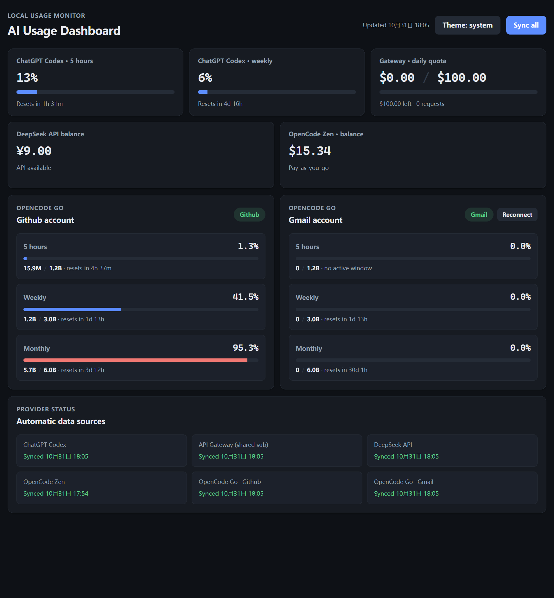

# AI Usage Dashboard

一个本地桌面仪表盘，把散落在多个网页/控制台里的 AI 用量与额度汇总到一个窗口，避免反复登录查看。界面跟随系统深浅色，也可在右上角手动切换 系统 / 浅色 / 深色。



## 支持的数据源

- **ChatGPT Codex** — 5 小时与每周窗口的用量百分比和重置时间。
- **API Gateway** — 任意 OpenAI 兼容的网关 / 共享订阅接口的每日用量：限额、已用金额、剩余与请求数。
- **DeepSeek API** — 实时账户余额。
- **OpenCode Zen** — 按量付费的充值余额（与下面同一账号）。
- **OpenCode Go** — 多个账号（如 Github、Gmail）各自的 5 小时 / 每周 / 每月用量、Token 与额度。

所有数据由本机应用直接调用官方接口获取，刷新一次或在后台定时同步。

## 什么是 API Gateway 额度？

有的订阅是按"团队共享"提供的，会包装成一个 **OpenAI 兼容的 API 网关（gateway）** 供多个工具共用——例如 OpenCode 里配置为 custom provider，或通过 CC Switch 之类的工具接入 Codex/Claude。这类接口通常有**按天 / 按周 / 按月的额度限制**。本仪表盘的 **Gateway** 卡片就是用来实时跟踪这类共享订阅的额度，避免估算剩余。

你可以在 `src/main.js` 顶部把网关地址换成自己使用的任意 OpenAI 兼容网关即可复用该卡片（配合环境变量或 `~/.codex/auth.json` 中的 API key）。

## 启动

```bash
npm install
npm start
```

## OpenCode Go 与 Zen

OpenCode Go 用量通过 **API key** 读取，不依赖浏览器登录：

```dotenv
# 两个账号各自的 service account / personal API key
OPENCODE_GO_API_KEY_1=oc_sk_...
OPENCODE_GO_API_KEY_2=oc_sk_...
```

放在项目 `.env`、上级目录 `.env` 或本机环境变量中均可（会按顺序合并读取）。

**OpenCode Zen** 是充值余额制（用的同一个 Gmail 账号），它的余额接口只接受网页会话。Gmail 卡片右上角的 **Reconnect** 用于刷新该会话，登录一次后即可长期自动读取；会话过期时再点一次即可。

> 说明：新版 OpenCode Console 把导航改为 Activity / Go / Models / Providers / Controls / Settings，并新增了 Service accounts（机器身份，用于 CI/自动化）、Go Teams 与 Extra Usage（额度用尽后使用余额）。Go 用量接口已支持 API key 直接调用，因此仪表盘不再需要为 Go 维护登录态。

## 数据隐私

本项目只在你自己的电脑上运行，不会收集或上传任何数据：

- 所有 API Key 从本机环境变量或本目录下的 `.env` 文件读取（`.env` 已被 gitignore，不会进仓库）。
- 用量数据直接请求官方接口，不经过第三方中转。
- OpenCode Go 登录会话用 Windows 凭据加密后仅保存在本机；明文 Cookie 导入后立即删除。
- 打开源码即可核对：凭据只出现在主进程，不会写入页面存储或任何日志。